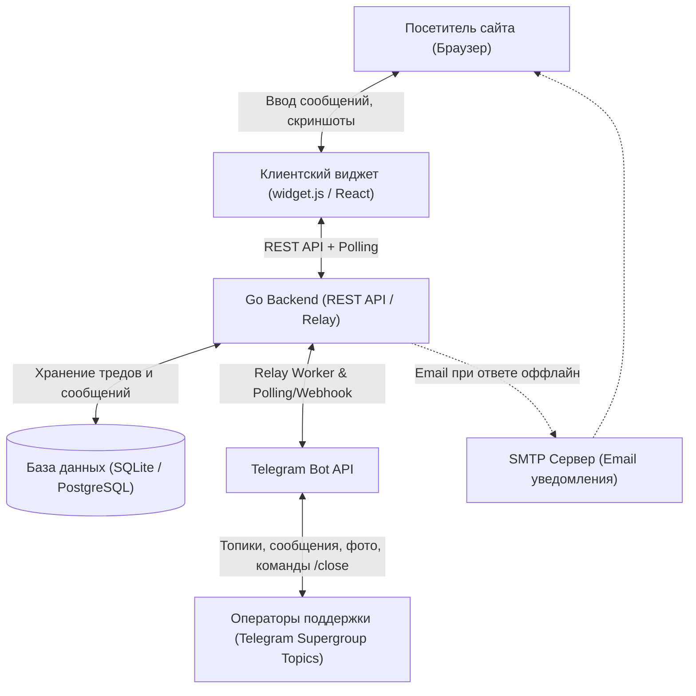
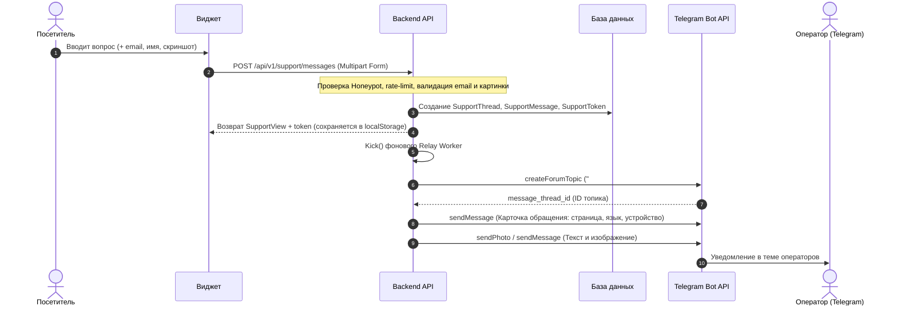
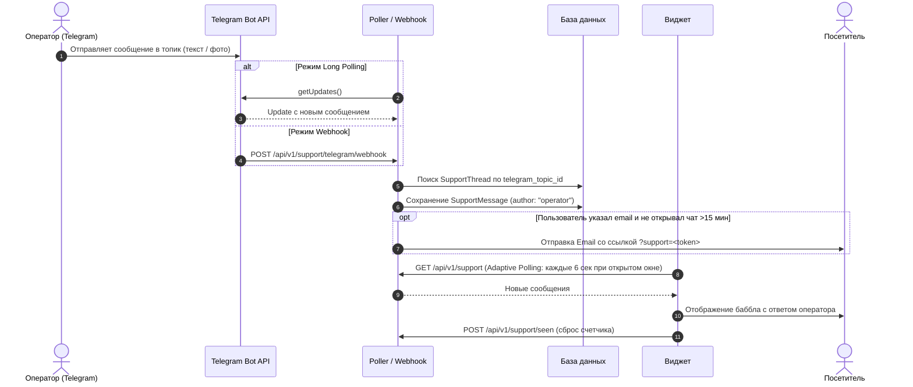

# Архитектура Support Chat

В этом документе подробно описана архитектура сервиса, поток передачи сообщений между веб-клиентом и Telegram, структура базы данных и механизмы фоновой синхронизации.

---

## 🏗 Общая схема системы

---

## 🔄 Поток обработки сообщений (Sequence Diagrams)

### 1. Отправка первого сообщения посетителем

---

### 2. Ответ оператора из Telegram

---

### 3. Закрытие и переоткрытие обращения

- Оператор отправляет команду `/close` прямо в топике Telegram:
  - Статус треда в БД меняется на `closed`.
  - В веб-чате появляется системное уведомление `Тема закрыта оператором`.
  - Топик в Telegram закрывается через `closeForumTopic`.
- Если посетитель пишет снова или оператор отправляет `/reopen`:
  - Статус треда меняется на `open`.
  - Топик в Telegram переоткрывается через `reopenForumTopic`.

---

## 🗄 Структура базы данных

### Таблица `support_threads`
| Колонка | Тип | Описание |
|---|---|---|
| `id` | VARCHAR(36) | Первичный ключ (UUID) |
| `number` | BIGINT | Порядковый номер тикета (#1, #2, ...) |
| `email` | VARCHAR(255) | Email автора обращения |
| `name` | VARCHAR(255) | Имя автора |
| `locale` | VARCHAR(10) | Язык (`ru`, `en`, `es`) |
| `status` | VARCHAR(20) | `open` или `closed` |
| `context` | TEXT | JSON с метаданными (page, user_agent, lang, custom) |
| `telegram_chat_id` | BIGINT | ID группы Telegram |
| `telegram_topic_id` | BIGINT | ID топика в группе |
| `user_seen_at` | TIMESTAMP | Время последнего прочтения пользователем |
| `emailed_at` | TIMESTAMP | Время последней отправки email-уведомления |
| `last_message_at` | TIMESTAMP | Время последнего сообщения в треде |
| `created_at` | TIMESTAMP | Дата создания |
| `closed_at` | TIMESTAMP | Дата закрытия |

### Таблица `support_messages`
| Колонка | Тип | Описание |
|---|---|---|
| `id` | VARCHAR(36) | Первичный ключ (UUID) |
| `thread_id` | VARCHAR(36) | Внешний ключ на `support_threads.id` |
| `author` | VARCHAR(20) | `user`, `operator`, `system` |
| `operator_name` | VARCHAR(100) | Отображаемое имя оператора |
| `text` | TEXT | Текст сообщения |
| `has_attachment` | BOOLEAN | Признак наличия скриншота/картинки |
| `telegram_message_id` | BIGINT | ID сообщения в Telegram |
| `relayed_at` | TIMESTAMP | Время успешной отправки в Telegram |
| `created_at` | TIMESTAMP | Дата создания |

### Таблица `support_attachments`
| Колонка | Тип | Описание |
|---|---|---|
| `message_id` | VARCHAR(36) | Внешний ключ на `support_messages.id` |
| `content_type` | VARCHAR(100) | MIME тип (`image/png`, `image/jpeg`, `image/webp`) |
| `data` | BLOB / BYTEA | Бинарные данные изображения |

### Таблица `support_tokens`
| Колонка | Тип | Описание |
|---|---|---|
| `token_hash` | VARCHAR(64) | SHA-256 хеш токена гостевой сессии |
| `thread_id` | VARCHAR(36) | Внешний ключ на тред |
| `created_at` | TIMESTAMP | Дата выдачи токена |
